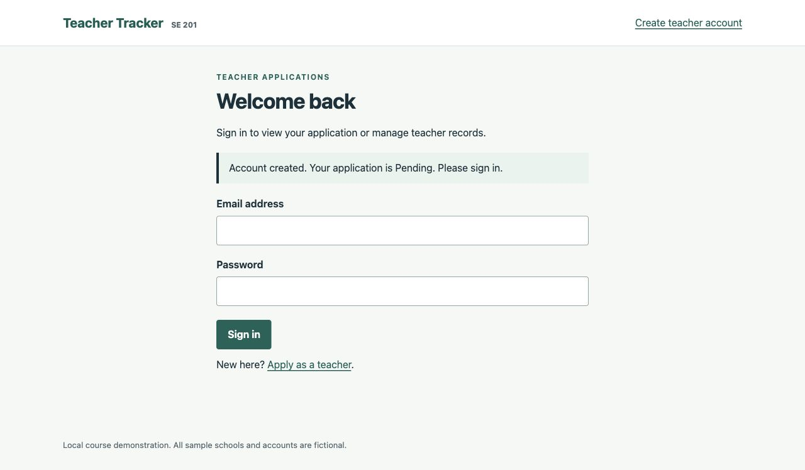
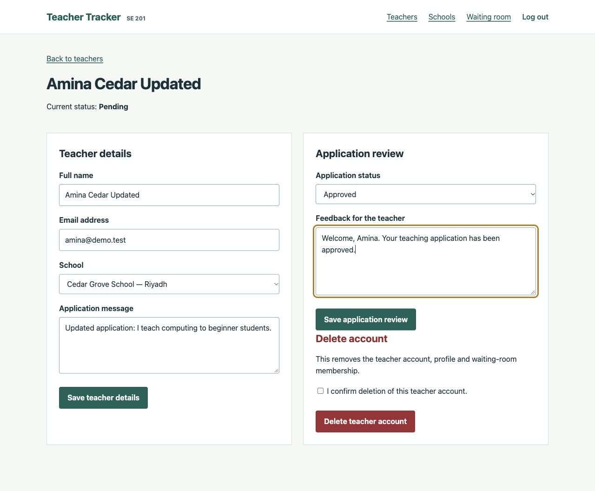
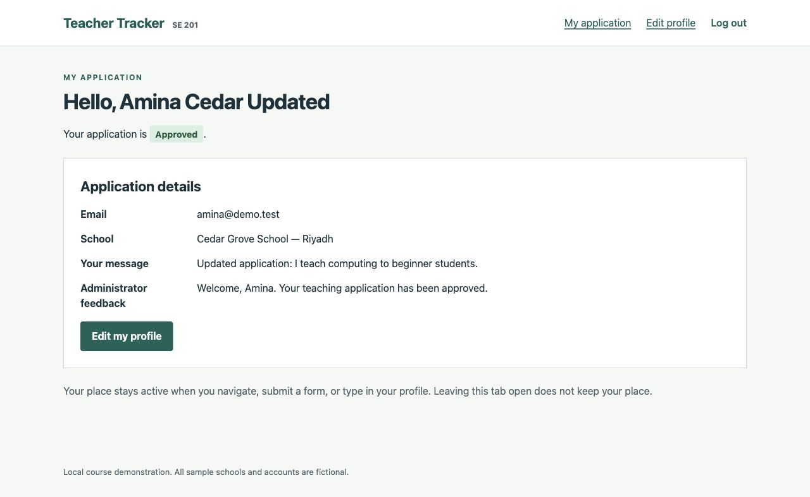
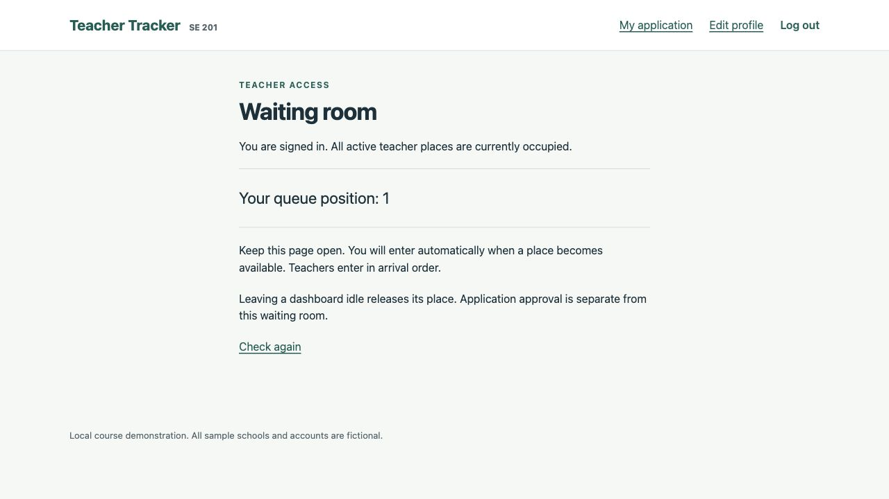
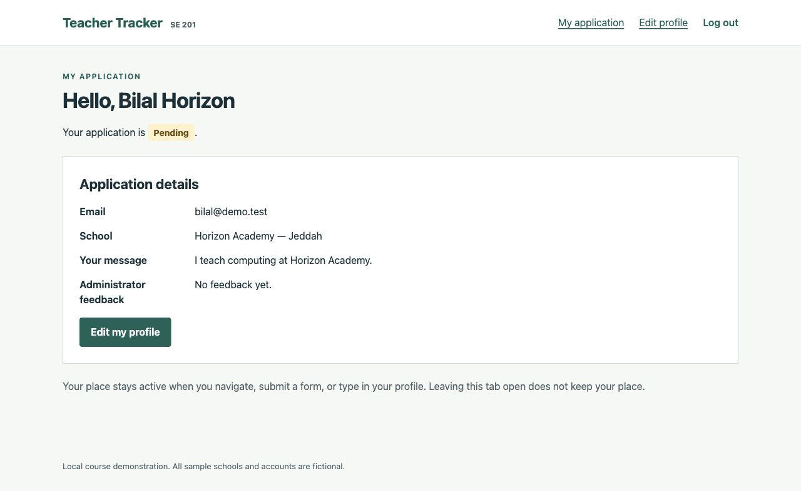
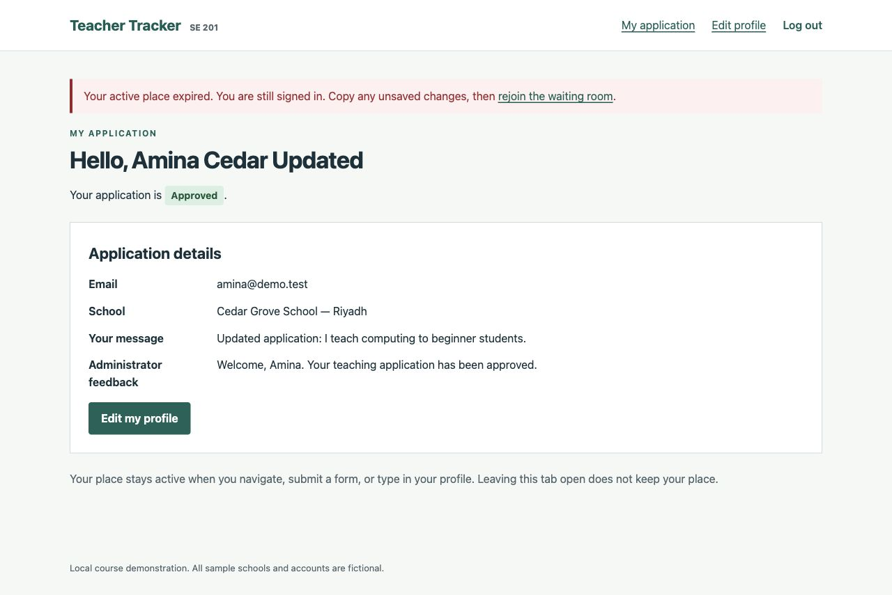
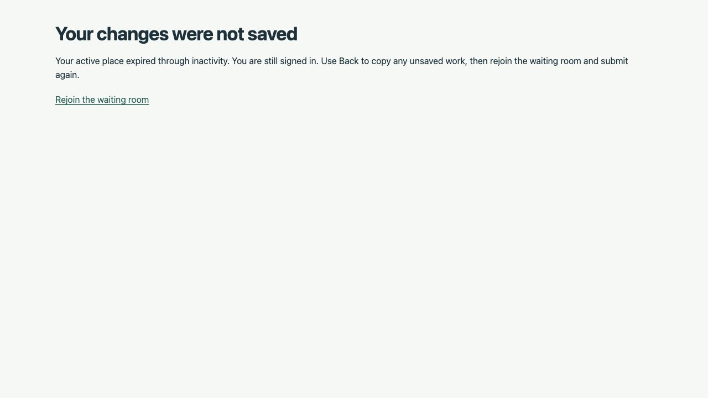

# Executed test cases and evidence

Verification took place on **October 29, 2026 (Asia/Riyadh)**, on macOS 26.6.2, Apple M4, 16 GB RAM and Oracle Java 26.0.1. Browser checks used Codex's in-app browser. Teachers A and B used separate host cookie sessions at 127.0.0.1 and localhost; the same running server/database served both. These were not two accounts sharing a single host's login cookie.

## Automated results

**25 tests passed, 0 failures, 0 errors, 0 skipped.** Twelve unit tests exercise admission with a controllable clock and concurrent requests. Thirteen application integration tests exercise Spring MVC, Security, validation and an isolated H2 database. [Individual results](automated-results.md) record each test name. The included Maven Wrapper was also used to execute the suite.

Automated coverage includes valid/invalid registration, case-insensitive duplicate emails, BCrypt verification, successful/failed login, role checks, stable ownership after email edits, rejected forged roles/status/account IDs, CSRF enforcement, escaped feedback, administrator CRUD/review, school protection, validated settings, atomic duplicate-email edits, optional idempotent demo seeding, FIFO, deduplication, bounded queues, stale waiters, activity renewal, polling behavior, lowering/raising limits, logout promotion and concurrency.

## Browser cases

All screenshots are genuine captures of the running application with fictional input. Passwords appear masked. No screenshot is a mockup. Screenshots of inputs and resulting pages are linked below. For inactivity, the input is the saved setting and the deliberate lack of interaction; there is no invented input form for elapsed time.

| ID | Functionality and preconditions | Input/action | Expected result | Actual result | Result | Evidence |
|---|---|---|---|---|---|---|
| TC-01 | Registration; seeded schools, no Amina account | Amina Cedar, amina@demo.test, Cedar Grove School, application message, valid demo password | Pending teacher account and sign-in confirmation | Account created; Pending confirmation shown | PASS | [Input](evidence/TC01-registration-input.jpg), [output](evidence/TC01-registration-result.jpg) |
| TC-02 | Duplicate validation; Amina exists | Submit AMINA@DEMO.TEST with otherwise valid data | Reject case variant; do not create duplicate | Registration page showed already-registered error and cleared password | PASS | [Input](evidence/TC02-duplicate-input.jpg), [output](evidence/TC02-duplicate-result.jpg) |
| TC-03 | Own profile edit; Amina signed in/admitted | Change name to Amina Cedar Updated and message | Persist changes, keep Pending status | Saved confirmation and updated dashboard, still Pending | PASS | [Before](evidence/TC03-pending-dashboard.jpg), [input](evidence/TC03-profile-input.jpg), [output](evidence/TC03-profile-result.jpg) |
| TC-04 | Review; administrator session and Amina record | Select Approved and enter welcome feedback | Persist review; teacher sees decision/feedback | Admin confirmation and teacher Approved dashboard matched | PASS | [Input](evidence/TC04-review-input.jpg), [admin output](evidence/TC04-review-result.jpg), [teacher output](evidence/TC04-teacher-approved.jpg) |
| TC-05 | Add teacher; administrator session | Bilal Horizon, bilal@demo.test, Horizon Academy, message and initial password | New teacher account with Pending status | Bilal's record opened with creation confirmation and Pending status | PASS | [Input](evidence/TC05-admin-create-input.jpg), [output](evidence/TC05-admin-create-result.jpg) |
| TC-06 | Capacity; two isolated teacher sessions | Save active=1, timeout=25, queue=10; admit A then sign in B | A active; B at position 1 | A dashboard and B waiting page showed expected accounts | PASS | [Settings](evidence/TC06-settings-input.jpg), [B login input](evidence/TC06-bilal-login-input.jpg), [A active](evidence/TC06-amina-active.jpg), [B waiting](evidence/TC06-bilal-waiting.jpg) |
| TC-07 | Inactivity; continue TC-06 with B waiting | Stop meaningful actions on A while leaving both pages open | A expires; B automatically enters despite polling | B dashboard appeared automatically; A showed expiry while staying signed in | PASS | [Input state](evidence/TC06-amina-active.jpg), [B admitted](evidence/TC07-bilal-auto-admitted.jpg), [A expired](evidence/TC07-amina-expired.jpg) |
| TC-08 | Persistent data; edited/reviewed Amina and saved settings | Stop Java process, restart updated JAR from same folder/database, sign in again | Same profile, school, approval, feedback and 1/25/10 settings | All those values were visible after restart; old login session did not persist | PASS | [Profile before](evidence/TC04-teacher-approved.jpg), [settings before](evidence/TC06-settings-input.jpg), [profile after](evidence/TC08-profile-after-restart.jpg), [settings after](evidence/TC08-settings-after-restart.jpg), [edited school after later restart](evidence/TC08-school-after-restart.jpg) |
| TC-09 | Referenced-school protection; Amina uses Cedar Grove | Administrator clicks Delete school on Cedar Grove | Clear refusal; school/teachers remain intact | Used-by-teachers message shown; school remained in list | PASS | [Input](evidence/TC09-school-delete-input.jpg), [output](evidence/TC09-school-protected-result.jpg) |
| TC-10 | School edit; fictional unused Maple Demo School added | Change city from Riyadh to Jeddah | Saved city shown in school list | School saved confirmation and Jeddah row | PASS | [Input](evidence/TC10-school-edit-input.jpg), [output](evidence/TC10-school-edit-result.jpg) |
| TC-11 | Active editing; limit=1, timeout=25, B waiting | Press a real editing key roughly every 9 seconds over 27 seconds | A remains active longer than original 25-second period; B waits | A editing page had no expiry and B remained at position 1 at 27 seconds | PASS | [A editing](evidence/TC11-active-editing.jpg), [B still waiting](evidence/TC11-other-teacher-still-waiting.jpg) |
| TC-12 | Expired form; leave A profile idle until expiry | Enter an unsaved message then submit Save my profile | Reject save and explain that changes were not saved | Explicit not-saved page; later dashboard retained the earlier saved message | PASS | [Input](evidence/TC12-expired-profile-input.jpg), [output](evidence/TC12-expired-profile-result.jpg), [stored message](evidence/dashboard-final.jpg) |

## Verification limits

Browser checks cover the core workflows above. The concurrency, malicious-request, duplicate-session, queue-full, lower-limit, stale-waiter and most detailed validation boundaries are covered by automated tests rather than screenshots for every variant. Windows and an M3 machine were not tested. No formal load, penetration or accessibility audit was performed. A requested narrow viewport override did not change the browser's actual 1280-pixel width, so narrow-screen behavior remains unverified; responsive CSS is implemented but no desktop screenshot is labelled mobile evidence.

During development, replacing a JAR while it was still running interrupted that test session. The application was stopped and restarted before continuing, and the README now explicitly says to stop before rebuilding. The final browser checks use the rebuilt application. Java 26 emits some Maven/Spring testing warnings about reflection/agent APIs; they did not fail the suite.

## Selected evidence

### Registration output

### Administrator review and teacher output

### Queue and inactivity handover

### Expired profile submission

