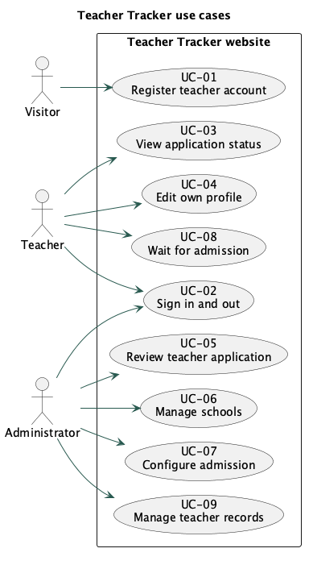
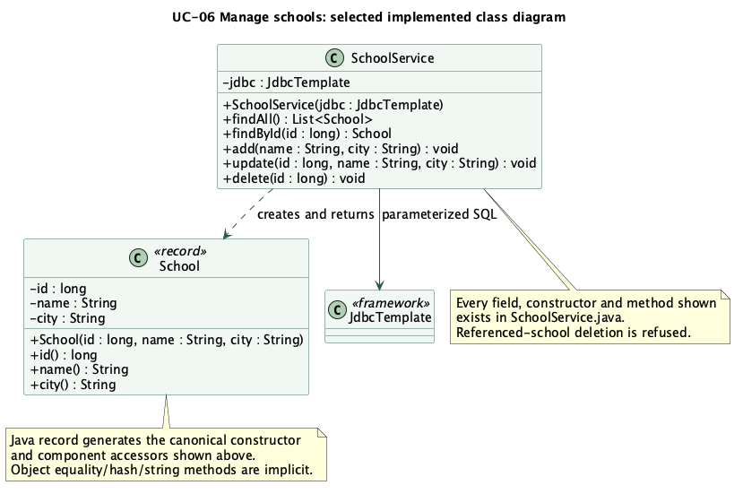
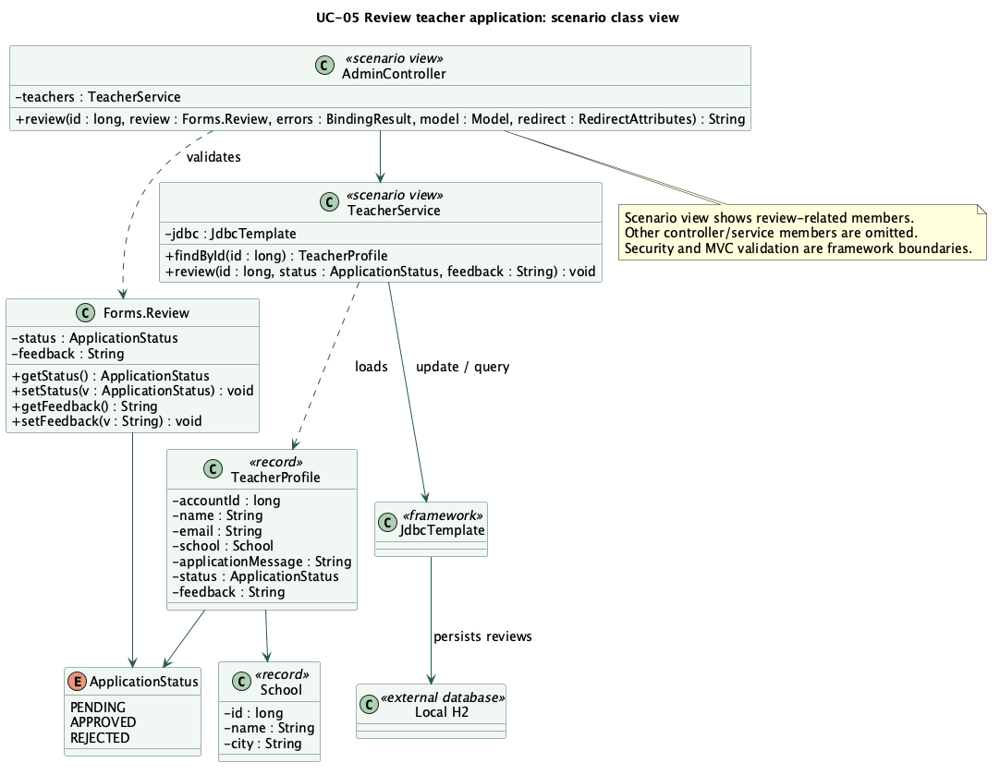
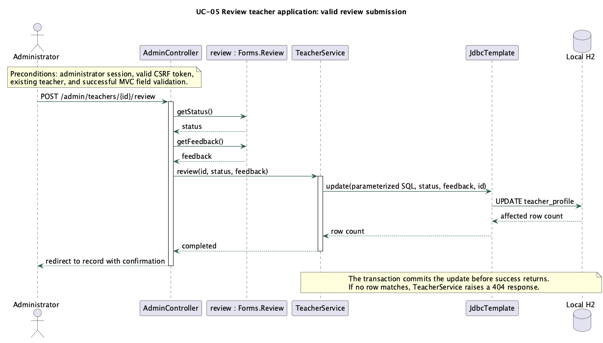

# UML models and implementation mapping

The diagrams were authored as editable PlantUML (`.puml`) and rendered locally with PlantUML 1.2026.9. SVG files can be opened in a browser and PNG files are included for reports. No Figma file, paid diagram service or source-repository asset is used.

## Use case model

[Editable source](diagrams/use-cases.puml) · [SVG](diagrams/use-cases.svg). Every case in the diagram has a description in [use-cases.md](use-cases.md).

## Class diagram 1: UC-06 Manage schools

This is the class diagram selected for the course coding requirement. It deliberately has a small, complete application model.

[Editable source](diagrams/class-schools.puml) · [SVG](diagrams/class-schools.svg).

| Diagram member | Exact implementation |
|---|---|
| School.id, School.name, School.city | Components in `src/main/java/edu/se201/tracker/School.java` |
| School(long, String, String) | Java record's generated canonical constructor |
| School.id(), name(), city() | Generated record component accessors |
| SchoolService.jdbc | Private final JdbcTemplate field |
| SchoolService(JdbcTemplate) | Constructor in SchoolService.java |
| findAll(): List<School> | Returns school rows ordered by name/ID |
| findById(long): School | Returns selected school or raises 404 |
| add(String, String): void | Inserts school inside a transaction |
| update(long, String, String): void | Updates school or raises 404 |
| delete(long): void | Refuses referenced school, otherwise deletes it or raises 404 |
| JdbcTemplate | Spring JDBC dependency, supplied by the framework |

All application attributes and operations shown are implemented. A Java record also has generated equals/hashCode/toString methods, which the diagram does not enumerate. JdbcTemplate is an external framework class, not student-written infrastructure. The controller handles HTTP and validation outside the selected service/domain class model.

## Class diagram 2: UC-05 Review teacher application

[Editable source](diagrams/class-review.puml) · [SVG](diagrams/class-review.svg).

This is an explicit scenario view: AdminController and TeacherService show the members relevant to reviewing an application. It does not claim to enumerate every member in those broader classes. Forms.Review contains the status/feedback fields and accessors shown. TeacherProfile is a record/projection joined from the account, profile and school tables; its email is read from user_account, not separately persisted in teacher_profile. ApplicationStatus has Pending, Approved and Rejected values in the interface and uppercase constants in code.

## Sequence diagram: UC-05 only

[Editable source](diagrams/sequence-review.puml) · [SVG](diagrams/sequence-review.svg).

The sequence shows the valid review submission after Spring Security checks role/CSRF and MVC validates Forms.Review. AdminController calls its accessors, TeacherService.review performs a parameterized update through JdbcTemplate, and the transactional proxy commits before the controller reports success. A missing teacher raises 404. Local H2 is an external database boundary, also shown in the review class model.

## Model consistency

The review sequence's application/framework objects all appear in class diagram 2. Its Administrator is the use case actor, and Local H2 is an external database. The sequence maps only to UC-05. The school diagram maps to UC-06 and directly identifies the implemented sample. Both class views refer to the same School and ApplicationStatus definitions. The use case descriptions and numbered requirements describe the final behavior, including preserved review status after ordinary teacher edits.

## Regenerating diagrams

With an official PlantUML JAR available, run `java -Djava.awt.headless=true -jar plantuml.jar -tsvg docs/diagrams/*.puml` or use a PlantUML editor. The sources select the bundled Smetana layout engine, so a Graphviz installation is unnecessary. PlantUML is documentation tooling only; it is not required to build or run the website.
